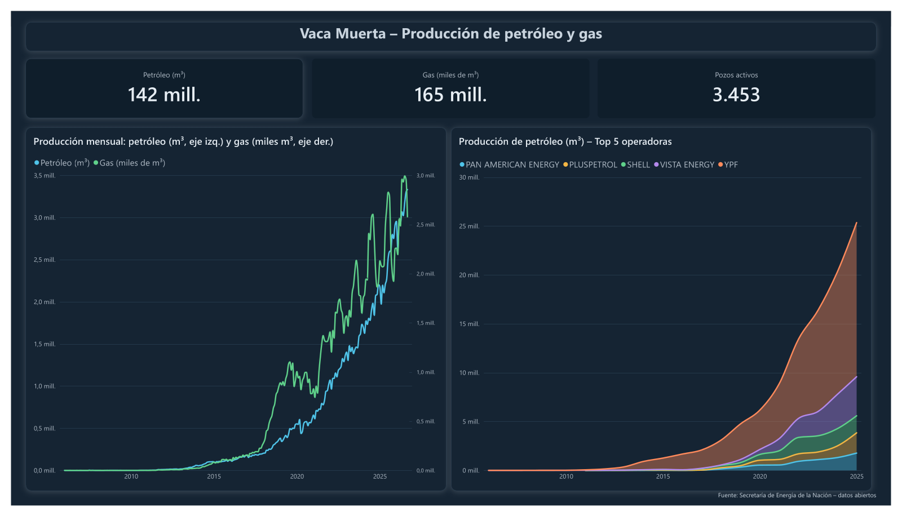
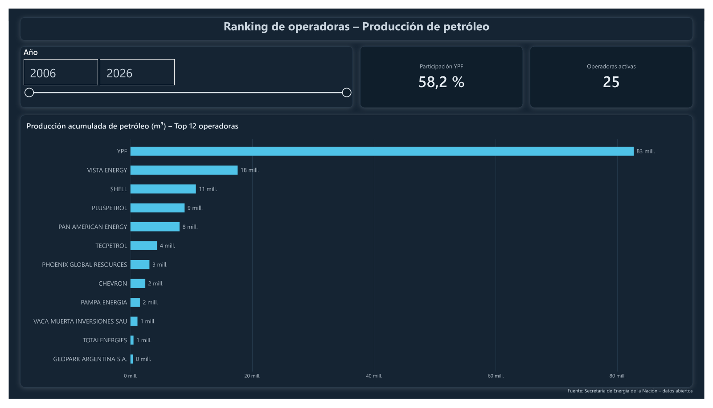
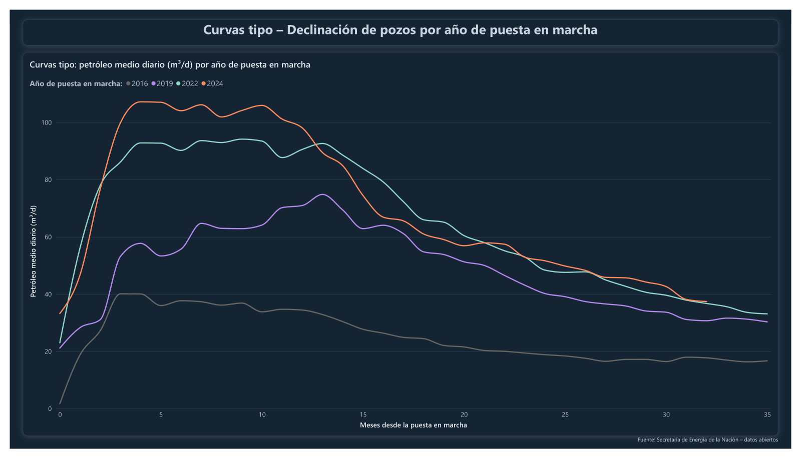
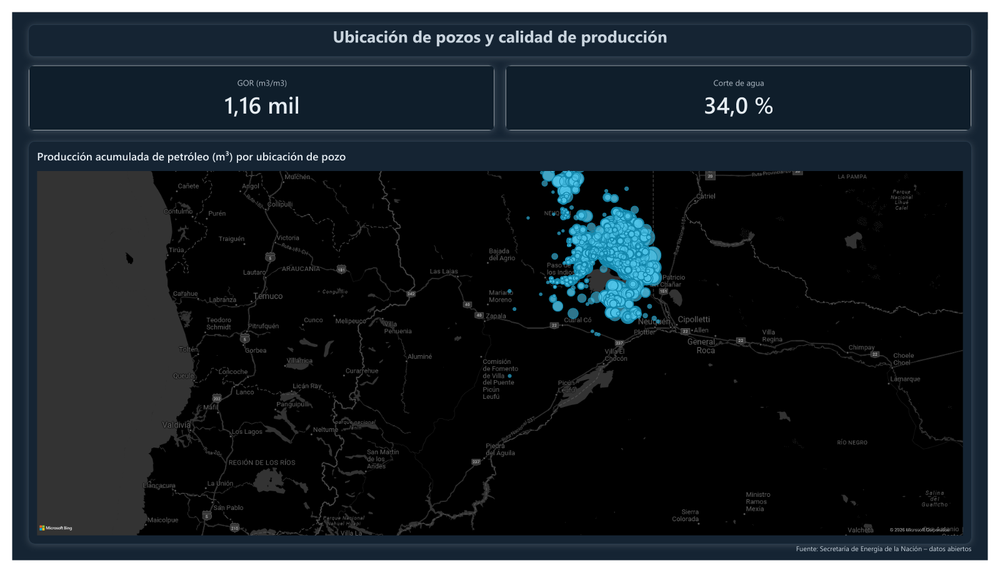

# Producción de Vaca Muerta — Pipeline de datos y dashboard

Análisis de la producción de hidrocarburos **no convencionales de Vaca Muerta**
(cuenca Neuquina) a partir de los **datos abiertos oficiales** de la Secretaría de
Energía de la Nación. El proyecto arma un pipeline reproducible **Python → SQL → DuckDB**
y un tablero en **Power BI** sobre un modelo estrella.

> Proyecto personal con fines de portfolio. Usa **exclusivamente datos públicos**
> publicados por el Estado Nacional; no contiene información interna de ninguna empresa.

---

## 📊 El dashboard

Cuatro páginas en Power BI sobre el modelo estrella. El archivo está en
[`vaca_muerta_dashboard_v2.pbix`](vaca_muerta_dashboard_v2.pbix).

### 1 · Panorama de producción


### 2 · Ranking de operadoras


### 3 · Curvas tipo — el análisis diferencial


> **Hallazgo:** al normalizar la producción por el *mes de vida* de cada pozo, se ve que
> **cada generación de pozos rinde más que la anterior**: los puestos en marcha en **2024**
> pican en **~108 m³/día**, contra **~40 m³/día** de los de **2016** — casi **3×**. Es el
> efecto de la mejora en perforación y fractura, y solo se interpreta con conocimiento de
> producción de hidrocarburos.

### 4 · Ubicación de pozos y calidad de producción


---

## 🎯 Qué muestra

- **Panorama:** evolución de petróleo y gas de Vaca Muerta y participación por operadora.
- **Ranking de operadoras:** YPF vs. Vista, Tecpetrol, Pan American, Shell, etc.
- **Curvas tipo:** producción diaria normalizada por *mes de vida* del pozo, agrupada
  por año de puesta en marcha. Responde si **los pozos nuevos rinden más que los viejos**
  (spoiler: los de 2024 pican en ~108 m³/día contra ~40 de los de 2016 — casi 3×).
- **Indicadores técnicos:** GOR, corte de agua y mapa de pozos por coordenadas.

---

## 🗂️ Fuente de datos

Dataset **"Producción de petróleo y gas por pozo (Capítulo IV)"** de
[datos.energia.gob.ar](http://datos.energia.gob.ar/dataset/produccion-de-petroleo-y-gas-por-pozo-capitulo-iv).
Actualización mensual. Recursos usados:

| Recurso | Uso |
|---|---|
| Producción de pozos de gas y petróleo **No Convencional** | Producción mensual por pozo (histórico 2006–hoy) |
| **Padrón** de pozos de Capítulo IV con fecha de primera producción | Fecha de puesta en marcha de cada pozo |

---

## ⚙️ Cómo correrlo

Requiere Python 3.10+.

```bash
# 1. Entorno e instalación
python3 -m venv .venv
source .venv/bin/activate            # en Windows: .venv\Scripts\activate
pip install -r requirements.txt

# 2. Descargar los datos abiertos (~145 MB)
python src/descargar_datos.py

# 3. Construir la base y exportar el modelo estrella
python src/construir_db.py
```

Esto genera:

- `data/vaca_muerta.duckdb` — base analítica consultable con SQL.
- `data/processed/*.csv` y `*.parquet` — las tablas del modelo listas para **Power BI**
  (Obtener datos → carpeta `data/processed`).

> El tablero de Power BI se arma en Windows (Power BI Desktop). El pipeline corre en
> cualquier sistema operativo y entrega los archivos que Power BI importa.

---

## 🏗️ Arquitectura

```
datos.energia.gob.ar
        │  descargar_datos.py (Python)
        ▼
   data/raw/*.csv
        │  construir_db.py  +  sql/*.sql  (transformaciones en SQL)
        ▼
   DuckDB  →  modelo estrella  →  data/processed/*.parquet,*.csv
        │
        ▼
     Power BI
```

Las transformaciones viven en SQL (carpeta [`sql/`](sql/)) y se ejecutan en orden:

1. `01_staging.sql` — carga cruda, recorte a Vaca Muerta y tipado de columnas.
2. `02_dimensiones.sql` — fecha de primera producción, `dim_pozo` (con **operadora
   normalizada**) y `dim_calendario`.
3. `03_hechos.sql` — `fact_produccion` con caudales diarios, indicadores y mes de vida.

### Limpieza destacada

- **Normalización de operadoras:** se unifican razones sociales del mismo grupo
  (p. ej. *VISTA ENERGY ARGENTINA SAU* / *VISTA OIL & GAS ARGENTINA SAU* → `VISTA ENERGY`).
- **Fecha de primera producción robusta:** padrón oficial, con respaldo en los propios
  datos para que ningún pozo quede sin *mes de vida*.
- **Tipado explícito** de medidas y coordenadas (el CSV llega todo como texto).

---

## ⭐ Modelo estrella

**`fact_produccion`** (grano: pozo × mes)

| Campo | Descripción |
|---|---|
| `id_pozo`, `fecha` | Claves hacia las dimensiones |
| `prod_pet_m3`, `prod_gas_dam3`, `prod_agua_m3` | Producción mensual (petróleo m³, gas miles de m³, agua m³) |
| `pet_m3_dia`, `gas_dam3_dia` | Caudales diarios (normalizados por días efectivos) |
| `gor_m3_m3` | Relación gas-petróleo |
| `corte_agua` | Fracción de agua (0–1) |
| `mes_vida` | Meses desde la primera producción (0 = primer mes) |

**`dim_pozo`** — `operadora` (normalizada), `empresa`, área/yacimiento, provincia,
tipo de pozo, `lat`/`lon`, `fecha_primera_produccion`, `anio_puesta_marcha`.

**`dim_calendario`** — `fecha`, año, mes, trimestre, `anio_mes`.

---

## 📁 Estructura

```
.
├── src/
│   ├── descargar_datos.py          # descarga de los CSV abiertos
│   └── construir_db.py              # orquesta el ETL y exporta el modelo
├── sql/
│   ├── 01_staging.sql
│   ├── 02_dimensiones.sql
│   └── 03_hechos.sql
├── img/                             # capturas del dashboard
├── tema_vaca_muerta_pro.json        # tema de Power BI (claro)
├── tema_vaca_muerta_pro_oscuro.json # tema de Power BI (oscuro, el usado)
├── vaca_muerta_dashboard_v2.pbix    # dashboard de Power BI
├── data/                            # se genera al correr los scripts (no versionado)
├── requirements.txt
└── README.md
```

---

## 🧰 Stack

Python · SQL · DuckDB · Power BI · datos abiertos (Capítulo IV, Secretaría de Energía)
